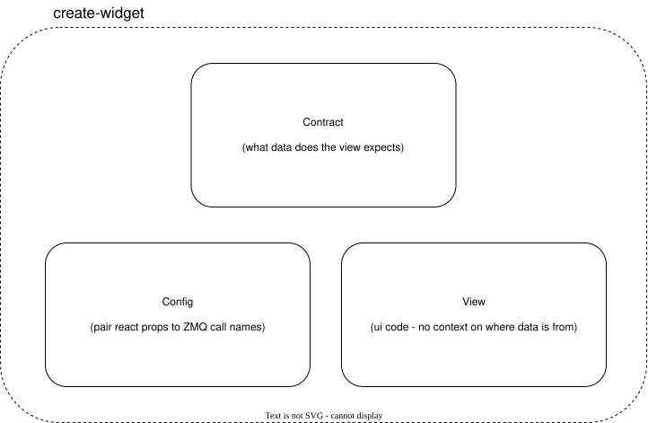
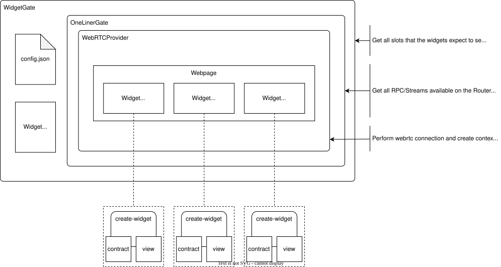

# Widget

- [Widget](#widget)
  - [Overview](#overview)
    - [Slot Types](#slot-types)
    - [Example](#example)
  - [Creating A Widget](#creating-a-widget)
    - [View](#view)
    - [Slots](#slots)
    - [Config](#config)
    - [Contract](#contract)
    - [Update View](#update-view)
    - [Widget Registry \& Creation](#widget-registry--creation)
    - [Usage](#usage)
  - [Diagrams](#diagrams)


## Overview 

Components of a widget: 

- Slots: labels for "props" (parameters) the `View` expects, and are eventually bind to their corresponding ZMQ function.
- View: pure UI component (isolated from the widget & `one-liner` details), accepts `Slots` as prop parameters.
- Contract: definitions of `Slots` that the view expects (prop to ZMQ call name mapping).



### Slot Types

There are 4 kinds of slot types: 

1) **action** action RPC (generally used as action - RPC call when a button is pressed)
2) **data:** data RPC (generally used to fetch data - loads data when UI initially loads)
3) **chanel:** generic data stream
4) **video:** video stream

### Example

Look at the ``MiceCloningFacility`` in ``frontned/src/widgets/MiceCloningFacility/`` for a full example. The files to pay attention to are: 

- Config: ``config.json`` in root folder
- Contract: ``MiceCloningFacility/contract.ts``
- View: ``MiceCloningFacility/view.tsx`` 


## Creating A Widget

There are 3 files that need to be created to construct a new widget. Create a new folder under `src/widgets/<WidgetName>` and then create the following files: 

- `view.tsx` - the UI component
- `contract.ts` - the contract
- `index.ts` - where the function that creates the widget lives and where the widget gets exposed for the rest of the app

### View

Its easiest to start with the **view**. Create a regular React component. For data coming from `one-liner`, represent them as regular props for now. They can be updated after the **contract** is created. 

Example:

```tsx
// view.tsx
// --------

// instanceId is used to distinguish multiple instances of this widget
// slot1 & slot2 are placeholders that correlate to a `one-liner` RPC or stream. 
// the name of slot1 and slot2 DO NOT need to match the call_name in `one-liner`
export const ExampleWidgetView = (instanceId: string, slot1: any, slot2: any) => {
  // add UI stuff here...
}
```

### Slots

There are 4 kinds of slots. Each placeholder props will eventually be replaced with one of the following resources:

1. RPC Action - for attaching RPC call to an event
2. RPC Data - for retrieving data from an RPC
3. Channel - for data streams
4. Stream - for video streams

Here are the shapes for these resources: 

```tsx
// For RPC actions (fired on user event).
export type ActionResource<TResult, TParams> = {
  call: (params: TParams) => void;
  callAsync: (params: TParams) => Promise<TResult>;
  result: TResult | undefined;
  isLoading: boolean;
  error: Error | null;
};

// For RPC data (fetched on mount, updated over time).
export type DataResource<TResult> = {
  data: TResult | undefined;
  isLoading: boolean;
  error: Error | null;
  refetch: () => void;
};

// For bidirectional data channels (subscribe + send).
export type ChannelResource<T> = {
  data: T | null;
  send: (payload: unknown) => boolean;
  isOpen: boolean;
};

// For media streams. Bound to a <video> via ref callback.
export type StreamResource = {
  ref: (element: HTMLVideoElement | null) => void;
};
```

### Config

In the `config.json` define the binding between widget `slots` to the corresponding zmq `call_name` exposed by the `RouterServer` on the instrument software. 

Example: 

```json
"exampleWidgetInstance1": {
  "type": "ExampleWidget",
  "bindings": {
    "slot1": "zmq_slot1_func",
    "slot2": "zmq_slot2_func"
  }
}
```

Note: there is no information about the type of each zmq function. Example `zmq_slot1_func` could be an RPC or a stream. The definition is defined in the next step in the contract.

### Contract

Next, create the **widget contract** by adding the following to the `contract.ts`:

```tsx
// contract.ts
// -----------

import { z } from 'zod';

export const ExampleWidgetContract = {
  type: 'ExampleWidget', // Unique name for the widget - can name it anything 
  slots: {
    /**
     * Definition for each slot with the following info: 
     *  - kind: what type of resource this slot is (rpc-data, rpc-action, channel, video)
     *  - param: parameter schema
     *  - results: result schema
     */
    slot1: {params: z.unknown(), results: z.unknown(), kind: 'rpc-data'} 
    slot2: {results: z.unknown(), kind: 'channel'}
  },
} as const; // <-- THIS IS CRITICAL
```

There are two shapes for the slot definition, one shape with the `params` defined and one without. The shape is determined by the `kind` of resource the slot is. 

- **'rpc-data'** and **'rpc-action'** require `params`, `results`, and `kind`. 
- **'channel'** and **'video'** only require `results`, and `kind`. They are one-directional (receive-only). This could possible change in the future.

### Update View

Now that the contract is defined and the slots are bound, update the props in the `view.tsx`

```tsx
// view.tsx
// --------

import { ExampleWidget } from './contract';

export type ExampleWidgetProps = ResourcesForContract<typeof ExampleWidgetContract> & {
  instanceId: string;
};

export const ExampleWidgetView = ({
  instanceId,
  slot1,
  slot2
}: ExampleWidgetProps) => {
  //...
}
```

After typing the props with `Resources`, there should be type-hinting for the props. Make sure to fix any issues.

### Widget Registry & Creation

Create the actual widget by adding the following to `index.ts`

```tsx
// index.ts
// --------

import { createWidget } from '@/widgets/framework';
import { MiceCloningFacilityContract } from './contract';
import { MiceCloningFacilityView } from './view';
export { MiceCloningFacilityContract } from './contract'; 

// pass the view & contract to the createWidget helper function to create the actual widget object
export const MiceCloningFacility = createWidget(MiceCloningFacilityContract, MiceCloningFacilityView);
```

Add the widget to the registry in `src/widgets/index.ts` (different `index.ts` than the one above).

```tsx
// src/widgets/index.ts
// --------------------

export { ExampleWidget } from './ExampleWidget';
import { ExampleWidget } from './ExampleWidget';

// NOTE: this is where you register a widget, everything else is derived from this
export const defaultWidgetRegistry = {
  ExampleWidget
} as const;
```

### Usage

The widget should be available to use in other parts of the application. Simply do the following to add it: 

```tsx
import { ExampleWidget } from '@/widgets';

function HomePage() {
  return (
    <ExampleWidget instanceId={'exampleWidgetInstance1'} />
  );
}
```


## Diagrams


